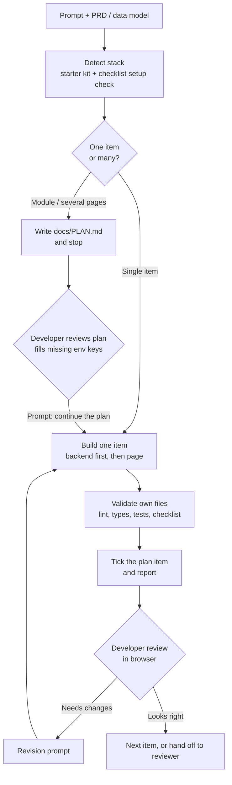

# tmdr-materio — Timedoor Materio skill

This repo is the home of the latest version of the skill. Get updates with `/plugin marketplace update timedoor-frontend`.

> [!NOTE]
> **tmdr-materio** is a Claude Code skill that turns a prompt and an optional supporting document (PRD or data model) into Materio Vuetify pages (`.vue`) that follow Timedoor's frontend standards. In Laravel projects it also builds the backend behind each page: migrations, models, form requests, controllers, routes, and tests. This README is for the people who run it: frontend and fullstack developers.

## Start here

### What the skill does

It detects which Materio variant your project is, checks that the Timedoor starter kit is in place, and then builds what you ask for. A single page or API is built straight away. A whole module or a PRD with several features is written down as a plan in `docs/PLAN.md` first, and the skill stops so you can review it. Every item is built from existing patterns and components, validated on the files it touched, and checked against the team's Frontend Developer Checklist.

### Supported stacks

| Variant | Detected by | Source root | Backend in scope |
| --- | --- | --- | --- |
| **Laravel** | Laravel backend with a Vue frontend inside: `artisan` and `resources/ts/pages/` | `resources/ts` | Yes. Backend items are planned and built (FE + BE by default). |
| **Vue (Vite)** | `src/pages/` and `vite.config.ts`, no `artisan` | `src` | No. Frontend only. |
| **Nuxt** | `nuxt.config.ts` | `app` (Nuxt 4) or the project root (Nuxt 3) | No. Frontend only. `server/api/` is read, never written. |

**Laravel still means Vue.** In a Laravel project the pages are the same Materio Vue (`.vue`) pages, kept in `resources/ts` inside the Laravel repo, so every frontend rule on this page applies to Laravel too. The only difference is that Laravel also gets the backend (migrations, models, controllers, and so on) planned and built next to the pages.

React, Next.js, plain HTML, and any other stack are not supported. The skill stops and tells you instead of guessing paths.

### What you get

- Pages under `<src>/pages/`, plus their own parts under `<src>/components/pages/<route>/`
- Sidenav entries and page titles for new top-level pages
- In Laravel FE + BE scope: migration, model, factory, form requests, policy, controller, API resource, routes, feature tests, and an entry in `docs/API.md`
- `docs/PLAN.md`, the plan that lets work resume in a brand-new conversation
- `docs/CHECKLIST.md` when you ask for a checklist audit
- A reply that flags new components, guessed limits, missing env keys, and the manual checks left for you

### What the skill does not do

- **It does not invent UI.** It reuses a pattern or an existing component. If neither covers a need, it composes a new component from Vuetify primitives and flags it with a warning in the reply.
- **It does not invent endpoints, response shapes, or permission names.** They come from `docs/API.md`, the backend code, or your PRD. If none say, it asks or leaves a marked TODO.
- **It does not fall back to stock Materio components.** If the starter kit is incomplete, it stops and lists what is missing.
- **It does not batch-generate a whole plan.** One plan item per run, so every item gets reviewed.
- **It does not touch your database destructively.** It never runs `migrate:fresh`, `migrate:refresh`, `migrate:reset`, `db:wipe`, or `db:seed`. It asks before `php artisan migrate`, and it will not run tests if the test configuration points at your development database.
- **It does not install packages or change app-wide config on its own.** New packages, `config/*`, `bootstrap/app.php`, and middleware changes need your go-ahead.
- **It does not run `npm run lint`.** That command rewrites the whole repo. The skill lints only the files it created or changed.
- **It does not mark manual checklist items as done**, and it never fills the Senior Dev Check column.

### Workflow at a glance



---

## Preparation

### Install the skill

As a plugin (recommended, gets updates):

```
/plugin marketplace add Timedoor-Front-End/frontend-materio-skills
/plugin install tmdr-materio@timedoor-frontend
```

Update later with `/plugin marketplace update timedoor-frontend`.

Manual: copy `skills/tmdr-materio/` into `~/.claude/skills/` (all projects) or `<project>/.claude/skills/` (one project). The structure must be `tmdr-materio/SKILL.md` plus a `references/` folder (with a `patterns/` folder inside it).

Then open your project in Claude Code from the project root.

### Prepare the project

> [!WARNING]
> The skill is built for the **Timedoor starter kit**, which is Materio plus project-level components, composables, config, and packages. A project created from stock Materio or an older kit will fail the check below, and the skill will stop rather than fall back to stock components.

Before the first page of a session, the skill checks that these pieces exist. It runs the check once per session, not per page.

| Piece (under `components/global/` unless noted) | What it is for |
| --- | --- |
| `page/PageHeader.vue` | Title, subtitle, automatic back button, `#status` and `#actions` slots. First element of every page. |
| `actions/ActionIconBtn.vue` | The only icon-only button. The tooltip is required. |
| `page/CardIcon.vue` | Icon tile in the header of every titled card. |
| `form/NumberField.vue` | The only numeric input. Money is an integer in minor units. |
| `form/DateTimeField.vue` | The only date and time input. Dates travel as `yyyy-MM-dd`, times as `HH:mm`. |
| `dialogs/ConfirmActionDialog.vue` | Confirmation before delete, cancel, or deactivate. |
| `composables/useServerTable.ts` | State for `VDataTableServer`. Search and filters are debounced 500ms, paging is immediate. |
| `utils/format.ts` and `utils/api.ts` | `formatRupiah`, `formatDate`, `initials`, `$api`, `apiErrorMessage`. |
| Auto-import config, `VForm` default, `.bg-info-block` style | `components/global` auto-imported, validation on blur and submit only (`validateOn: 'blur lazy'`). |
| npm packages | `cleave-zen` and `@vuepic/vue-datepicker` **v14**. |

If anything is missing, the skill lists the missing pieces and stops. After a passing check it records `> Starter kit: OK (date)` in `docs/PLAN.md`, so a new session can skip the check.

#### Checklist setup (non-blocking)

The team's Frontend Developer Checklist needs a few app-wide pieces that a single page cannot add. The skill checks them right after the starter kit check. Open items do **not** block page generation, except S8 for a page with a date-of-birth field. The skill lists them once and offers to apply them; each one needs your confirmation.

| ID | Setup item |
| --- | --- |
| S1 | Offline banner |
| S2 | Page title and description from `meta.title` |
| S3 | Friendly API errors that hide 5xx and network details |
| S4 | HTTPS enforced in production |
| S5 | Console and debugger stripped from production builds |
| S6 | Route auth guard and logout in the user menu (report only, built by the auth module) |
| S7 | `PageHeader` title rendered as the page's `h1` |
| S8 | `DateTimeField birth-date` prop (blocks pages with a date-of-birth field) |
| S9 | reCAPTCHA v3 for public forms that write data |
| S10 | Versioning: app version in the footer, API under `/api/v1` |
| S11 | SonarQube (`sonar-project.properties`) |
| S12 | Custom favicon (the skill asks for the logo and never makes one up) |
| S13 | Sentry on the frontend and, in Laravel, the backend |

The result is recorded in the plan header, for example `> Checklist setup: open S11, S13 (date)`.

### Prepare the supporting document

The skill works from your prompt alone, but a PRD or data model makes the result far more complete. Attach it or point to it in the prompt.

| Put this in the document | Why it matters |
| --- | --- |
| Pages, features, and fields per feature | Defines the plan, the form fields, and the table columns. |
| Limits per field (max length, ranges) | Used for the frontend `maxlength`, `NumberField` bounds, the backend rule, and the column size. Without them the skill uses default limits and flags each guess. |
| Roles and who may do what | Used for `action` and `subject` on pages and nav, and for backend policies. The skill never invents permission names. |
| Business rules and statuses | Becomes validation, status chips, and blocked actions. |
| External services (mail, payment, storage, SMS, maps) | Becomes the Environment table in the plan, so you can prepare keys before work starts. |
| Link to the Figma or XD design | The skill follows the design wherever it differs from a pattern's default shape, still using kit components, and lists what it could not match. |

If a requirement is ambiguous in a way that changes what gets built (fields, business rules, who may do what), the skill asks instead of guessing.

---

## Running the skill

### Prompt templates

The skill triggers on phrasing like "generate page for...", "build the invoice module", or "buat API customer" (an Indonesian example), in any language. It replies, and writes new plan text, in the language of your prompt. Code, file names, and identifiers always stay in English.

**One page**

```
Use the tmdr-materio skill.
Build the login page.
```

**One backend resource (Laravel)**

```
Use the tmdr-materio skill.
Build the customers API from docs/PRD.md.
```

**A whole module or PRD (writes a plan, then stops)**

```
Use the tmdr-materio skill.
Plan the Invoices module from docs/PRD.md.
```

**Frontend only in a Laravel project**

```
Use the tmdr-materio skill.
Build the customer list page. Frontend only, the backend already exists.
```

**Resume a plan**

```
continue the plan
```

**Audit against the checklist**

```
run the checklist
```

### Tips

- **Review the plan before building.** A new plan is shown and the skill stops. Read it, fill in missing env keys, then say "continue the plan".
- **Choose the scope early.** In a Laravel project the default is FE + BE. Say "FE only" or "the backend already exists" (any wording, in any language) if the backend is done elsewhere. The choice is recorded in the plan header (`> Scope: FE + BE` or `> Scope: FE only`).
- **One item per run.** A page, an API, or a revision. A small backend item and the page that uses it may go together.
- **A new session needs no memory.** `docs/PLAN.md`, not the chat, is what lets a new conversation continue from the first unchecked item.

---

## How a plan works

For multiple pages, a whole module, or a PRD with several features, the skill writes `docs/PLAN.md` and stops. It updates the file in place and never creates a second copy such as `PLAN_v2.md`. If a legacy `docs/PAGE_PLAN.md` exists, it is renamed to `docs/PLAN.md` with every checkbox state kept.

```markdown
# Plan
> Generated from: docs/PRD.md (2026-10-20)
> Stack: Laravel · Scope: FE + BE
> Starter kit: OK (2026-10-20)
> Checklist setup: open S11, S13 (2026-10-20)

## Environment
| Key | Module | For | Status |
|---|---|---|---|
| DB_DATABASE, DB_USERNAME, DB_PASSWORD | 1 | database | ✅ set |
| MAIL_MAILER, MAIL_HOST, MAIL_USERNAME, MAIL_PASSWORD | 1 | password reset email | ❌ missing |

## Module 1: Authentication
Status: pending · Env: `DB_*`, `MAIL_*`
- [ ] [BE] Auth API → POST /api/auth/login, POST /api/auth/logout, GET /api/auth/me
- [ ] [FE] Login page → uses: POST /api/auth/login, GET /api/auth/me

## Module 2: Customers
Status: pending · Env: —
- [ ] [BE] Customers API → GET/POST /api/customers, GET/PUT/DELETE /api/customers/{id}
- [ ] [FE] Customer list page (+ create/edit dialog) → uses: /api/customers
```

| Part | Meaning |
| --- | --- |
| `[BE]` item | Laravel FE + BE scope only. The API for one resource: migration, model, factory, requests, policy if needed, controller, resource, routes, tests, and its entry in `docs/API.md`. |
| `[FE]` item | One page with its own dialogs and parts. Lists the endpoints it uses. |
| Order | Modules are ordered by dependency (authentication first). Inside a module, every `[BE]` item comes before the `[FE]` items that use its endpoints. |
| Module status | `pending`, then `in progress` once any item is checked, then `done` when all are. |
| Environment table | Every env key the plan needs, with presence checked in `.env`. The skill only reads whether a key is set. It never reads, prints, or copies a value. |

### Environment keys

Before an item starts, the skill checks the env keys of its module. If a key is missing and has no alternative recorded, it **stops before writing code**. It lists the keys and what each is for, then asks you to either fill them in `.env` or proceed with an alternative that works without the value, for example `MAIL_MAILER=log`, local disk instead of object storage, the provider's sandbox, or the feature hidden behind a config check. Your choice is recorded in the table as `↪ alternative`.

In FE-only scope, the backend's keys are not planned. The skill says once that the backend team provides them.

---

## Conventions the skill enforces

These are the rules a generated page follows. They are useful to know when you review the output.

| Area | Rule |
| --- | --- |
| Where things come from | Layer 1: `references/patterns/*.md` (auth, invoice, user/role/permission, dashboard, dialogs, cards, forms and wizard, tables, page header). Layer 2: `references/component-catalog.md`. Only after both fail, a new component, flagged in the reply. |
| File structure | Pages under `<src>/pages/`. Reusable components in `components/global/<category>/` (auto-imported). One-page parts in `components/pages/<route>/` (imported explicitly). Never a `views/` folder. |
| TypeScript | `<script setup lang="ts">`. Typed props and emits. No `any`: every API response and payload has an interface. |
| Reactivity | State in `ref` or `reactive`. Derived values are `computed`. `watch` only for side effects. Page-load data goes through `useApi` or `useServerTable`, never `onMounted` plus `$api`. |
| Page layout | Every page in the `default` or `public` layout starts with `PageHeader`, which is the page's only `h1`. Create and edit pages put Cancel and Save in its `#actions` slot. |
| Create and edit | A dialog when the form has about four simple fields or fewer, no conditional fields, no upload or add/remove rows, and nobody needs a direct URL. Otherwise a page. |
| Forms | Validation on blur and submit. Required labels end with  `*` and use `requiredValidator`. The submit handler starts with `validate()` and returns if invalid. Empty values are `null`, never `''` or `undefined`. |
| Inputs | `DateTimeField` for dates and times, `NumberField` for numbers, never `type="number"`, `type="date"`, or `AppDateTimePicker`. Every input has an upper bound that matches the backend rule and the column. |
| Buttons and dialogs | Icon-only buttons are `ActionIconBtn` with a tooltip. Destructive actions go through `ConfirmActionDialog`. Every dialog has `DialogCloseBtn` and a Cancel button, and closes on Esc or an outside click (no `persistent`). |
| Navigation | A new top-level page gets a nav item with the same `action` and `subject` as its page. Nested pages set `navActiveLink` to the parent route name as a string. Every link points to a route that exists. No `href="#"`. |
| Responsive | `VRow` and `VCol` with `cols="12"` plus `sm` and `md` widths. No fixed pixel widths on containers. Tables scroll inside their card, and the page never scrolls sideways. |
| Loading and empty states | Tables use `:loading` and `no-data-text`. Other fetched lists and detail blocks get a loading and an empty state. |
| Images and links | Every image has `alt`. A missing dynamic image falls back to `placehold.co`; people show initials instead. External links use `target="_blank" rel="noopener noreferrer"` and `https://` only. |
| Sensitive data | Password fields use `type="password"` with the eye toggle, and forms that set a password use `autocomplete="new-password"`. Forms with personal, financial, or medical identifiers use `autocomplete="off"`. Such values never go in a URL. `v-html` only for HTML the backend sanitizes. |
| Debug code | No `console.*`, `debugger`, commented-out code, or dummy data in generated files. |

### Default input limits

When the PRD does not give a limit, the skill uses these defaults. Anything outside this table is a fallback, and the skill flags every fallback in its reply.

| Field | Limit |
| --- | --- |
| Person or entity name | 100 characters |
| Username | 30 characters |
| Email | 254 characters |
| Password | 8 to 72 characters |
| Phone | 20 characters |
| Title or short label | 150 characters |
| URL | 2048 characters |
| Address | 255 characters |
| Short description or note | 500 characters |
| Quantity | 1 to 9999 |
| Money | 0 to 9,000,000,000,000,000 minor units (always integer, never falls back) |
| File upload | Image 2 MB, document 5 MB, with a type whitelist |

---

## Data and authentication

For pages that talk to an API, the skill first learns the project's API conventions once per session: base URL, auth mode, validation error shape, success shape, pagination shape, and key casing. It reads them from project docs (`docs/API.md`, `CLAUDE.md`), the fetch helpers (`useApi`, `$api`), the backend code, and finally your prompt or PRD. If docs and helpers disagree, it stops and tells you.

| Auth mode | Detected by |
| --- | --- |
| A. Bearer token | Docs say token or JWT, or helpers attach `Authorization: Bearer` (Materio default: `accessToken` cookie) |
| B. Session cookie | Docs say session or cookie auth (Laravel Sanctum SPA); helpers send a CSRF header |
| C. Nuxt server-side | `server/api/` handles auth, or an auth module is in `nuxt.config.ts` |
| D. No auth | Public-only app or page |

The skill picks one mode and never mixes them. Across all modes: login, logout, and password reset are `POST`; login errors are generic; forgot-password always shows the same message; logout clears every client-side trace of the session, even if the request fails; and public forms that write data send a reCAPTCHA token.

### Laravel backend contract

In Laravel FE + BE scope, backend items are shaped to plug straight into the frontend helpers. If the existing code does otherwise, the skill follows the repo and adapts the frontend helper once, and flags it.

| Topic | Contract |
| --- | --- |
| Validation errors | `422` with `{ message, errors: { field: [msg] } }`. Business-rule failures are also `422`. |
| Lists | Accept `page`, `per_page`, `sort_by`, `sort_order`, and `q`. Return Laravel's paginator JSON. `sort_by` is whitelisted, `per_page` is capped, and search and sort happen in the query. |
| Money | Integer in minor units, stored as a big integer. Never floats. |
| Dates and times | `Y-m-d` and `H:i`. Timestamps as ISO 8601. |
| Delete | Only if the PRD asks. `204` on success, `422` if blocked by a business rule. |
| Uploads | Type validated by file content, not extension. Stored under a generated name. Private files are served through an authorized endpoint. |
| Logs | Never log request bodies, passwords, tokens, OTPs, or personal identifiers. |
| Documentation | Every resource gets an entry in `docs/API.md` with paths, auth, request fields, response example, error cases, and list parameters. The frontend items read it as the contract. |

---

## Reading the output

### Where files land

```
<project>/
├── docs/
│   ├── PLAN.md          # plan, written for modules and multi-page requests
│   ├── API.md           # API contract, kept in sync by backend items
│   └── CHECKLIST.md     # written by a checklist audit
├── resources/ts/        # <src> in Laravel (src in Vue, app in Nuxt 4)
│   ├── pages/...
│   ├── components/
│   │   ├── global/<category>/        # reusable, auto-imported
│   │   └── pages/<route>/            # one page's own parts
│   └── navigation/
├── app/ database/ routes/ tests/     # Laravel backend items
```

### The reply

Read the reply **before** opening the page. It is where the skill tells you what to check.

| What you may see | What it means |
| --- | --- |
| A warning that no existing pattern or component covered a need | A new component was composed from Vuetify primitives. Review it closely. |
| A warning that a field uses the default limit | The PRD gave no limit and no default row fit. Confirm the limit. |
| Missing env keys | Keys the next items need, so you can start getting them. |
| Starter kit or checklist setup findings | Missing kit pieces (stops the run) or open S-items (do not block). |
| Design pieces it could not match | Only when a Figma or XD link was given. |
| Manual items this item touches | For example which screen sizes to check or which frame to compare. These are yours to verify. |
| Anything it could not run | No test database, migration not applied. The item stays unchecked until it passes or you accept it. |

### Validation the skill runs

On the files it created or changed only:

- **Frontend:** `npx eslint --fix <files>`, and the project's `typecheck` script if there is one. It fixes errors in its own files and only reports errors elsewhere.
- **Backend:** `vendor/bin/pint <files>`, `php artisan route:list --path=<prefix>`, the item's feature tests (after confirming the test database is not yours), and static analysis if the repo has it.
- **Checklist:** the code-level checks from `references/checklist.md` on its files.

These do **not** prove runtime behavior or visual accuracy. You confirm those in the browser.

---

## Review and revision

### How to review

1. Read the reply, especially the warnings and the manual items.
2. Run the app and open the page. Compare it with the design if one was linked.
3. Click through every flow: create, edit, delete with its confirmation, empty list, validation errors, loading.
4. Resize to about 360, 768, and 1280 px. Check that nothing is cut off and the page does not scroll sideways.
5. For backend items, review the migration before you run it, and check `docs/API.md` against the routes.

### How to request revisions

Be specific about where the problem is and what you expect. One line per issue works best.

| Precise | Vague |
| --- | --- |
| `customers/index.vue`: the status filter should default to "active", it currently shows all | "The filter is wrong" |
| `CustomerDialog`: name max length should be 150, not 100 | "Fix the form limits" |
| `POST /api/customers`: return 422 when the email already exists, it returns 500 | "The API errors" |

When the fix changes an endpoint, ask the skill to update `docs/API.md` and the affected plan items too.

---

## Auditing with the checklist

Before a release or a senior review, run the audit:

```
run the checklist
```

The skill runs the project setup check and every code-level check on the whole project, reads the code where a search cannot decide, and writes `docs/CHECKLIST.md` with all 59 items from the team's Frontend Developer Checklist. It updates that file in place.

| Developer Check | Meaning |
| --- | --- |
| `Checked` | Verified. The evidence is a file and line, a command and its result, or the setup item that is in place. |
| `Not Checked` | Fails or is missing. Says what and where. |
| `Manual` | Needs a person, a browser, a design file, or the server. Says exactly what to verify. |
| `N/A` | The feature does not exist (no upload, no date of birth, no public form). Says why. |

The **Senior Dev Check** column always stays `Not Checked`. It belongs to the reviewer. The skill replies with the count per status and each failing item with a proposed fix, but **fixes nothing in the same turn**. Fixes become plan items, or a one-off change once you agree.

---

## Handoff to reviewers

> [!TIP]
> The generated code is meant to be reviewed like any teammate's pull request. Share this section with the senior developer who reviews it.

- **The plan is the source of truth for progress.** `docs/PLAN.md` shows what is built, what is pending, and which env keys are still missing.
- **`docs/API.md` is the contract** between backend and frontend items. If it disagrees with the backend code, the code wins and the doc is corrected.
- **Look at the flagged items first.** New components, fallback limits, and open checklist setup items are called out in the reply and the plan header.
- **Use `docs/CHECKLIST.md`** for the Senior Dev Check column. Evidence is listed per item.
- **Reusable pieces are shared.** A part used by a second page moves from `components/pages/` to `components/global/`.
- **Migrations are never edited once committed.** Changes arrive as new migrations.

---

## FAQ

- Why does the skill stop when the starter kit is incomplete?
    
    The conventions require kit components such as `PageHeader`, `NumberField`, and `DateTimeField`. A project from stock Materio or an older kit does not have them. Falling back to stock components would break the team's rules silently, so the skill lists what is missing and waits for your decision.
    
- Why did it write a plan instead of building my pages?
    
    Requests that cover several pages, a whole module, or a PRD with several features are planned first so you can review the scope and order. Say "continue the plan" to build the first unchecked item. A single clearly scoped page or API is built straight away.
    
- Can I use it on a project where the backend is someone else's?
    
    Yes. In Laravel, say "FE only" or "the backend already exists" (any wording, in any language). In Vue and Nuxt projects it is always frontend only, and backend requirements in a PRD are not planned.
    
- Does it work with Nuxt?
    
    Yes. Everything applies with small substitutions: `definePageMeta` instead of `definePage`, `NuxtLink` and `navigateTo` instead of `RouterLink` and `useRouter`, route middleware instead of router guards, and `useRuntimeConfig().public.*` instead of `import.meta.env.VITE_*`. `useApi` and `$api` keep their names but wrap `useFetch` and `$fetch`.
    
- What happens if a key in .env is missing?
    
    The skill stops before writing code for that module. It lists the missing keys and what each is for, and asks you to fill them in or choose an alternative, such as `MAIL_MAILER=log` or the provider's sandbox. It only checks whether a key is set and never reads or prints its value.
    
- Why does it ask before running migrations or tests?
    
    Tests that use `RefreshDatabase` wipe the database they connect to. The skill checks that the test configuration points at a test database first, and asks before running `php artisan migrate` on yours. If either is unsafe, it tells you to run the step yourself.
    
- Can it use a button or component that is not in the kit?
    
    Only as an escalation. If no pattern or catalog component covers the need, it builds one from Vuetify primitives and flags it in the reply. It never silently invents a component, and it never uses stock Materio demo components that the kit removed.
    
- Why are some input limits flagged as guesses?
    
    Every input needs an upper bound that matches the backend rule and the database column. The limit comes from the PRD first, then the default table, then a fallback. Fallbacks are guesses, so the skill flags each one for you to confirm. Money never falls back.
    
- Does it fix problems found by the checklist audit?
    
    Not in the same turn. The audit reports the gaps with proposed fixes. After you agree, the fixes become plan items or a one-off change.
    
- Can it build React, Next.js, or plain HTML pages?
    
    No. The skill only supports Materio Vue, Nuxt, and Laravel. On any other stack it stops and says so.
    

---

## Changelog

| Date | Changes |
| --- | --- |
| 2026-10-20 | First version of this documentation, covering stack detection, the starter kit check, planning with `docs/PLAN.md`, frontend and Laravel backend generation, and checklist audit mode. |